<p align="center">
  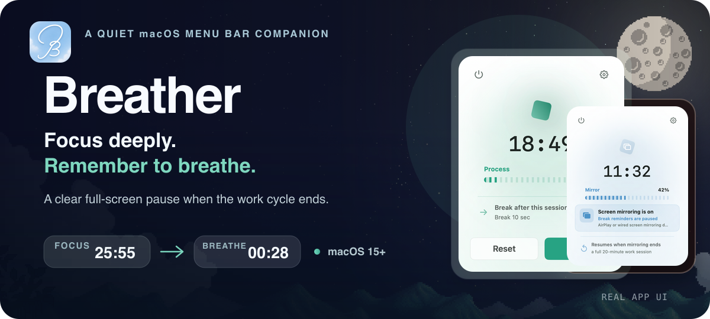
</p>

<p align="center">
  <a href="README.md"><strong>English</strong></a> · <a href="README.zh-CN.md">简体中文</a>
  <br><br>
  <a href="https://github.com/M3tar/Breather/releases/latest"><strong>Download Breather DMG</strong></a> · <a href="#install-with-homebrew">Install with Homebrew</a> · <a href="#release-history">Release history</a>
</p>

I made Breather to remind myself to pause. When I am making something, I can sit for hours. I know I should rest, yet it is easy to dismiss another reminder without thinking.

So Breather stays quietly in the macOS menu bar. When it is time for a break, it gives every connected display a little space to slow down. Stand up, drink some water, look into the distance, and come back when you are ready.

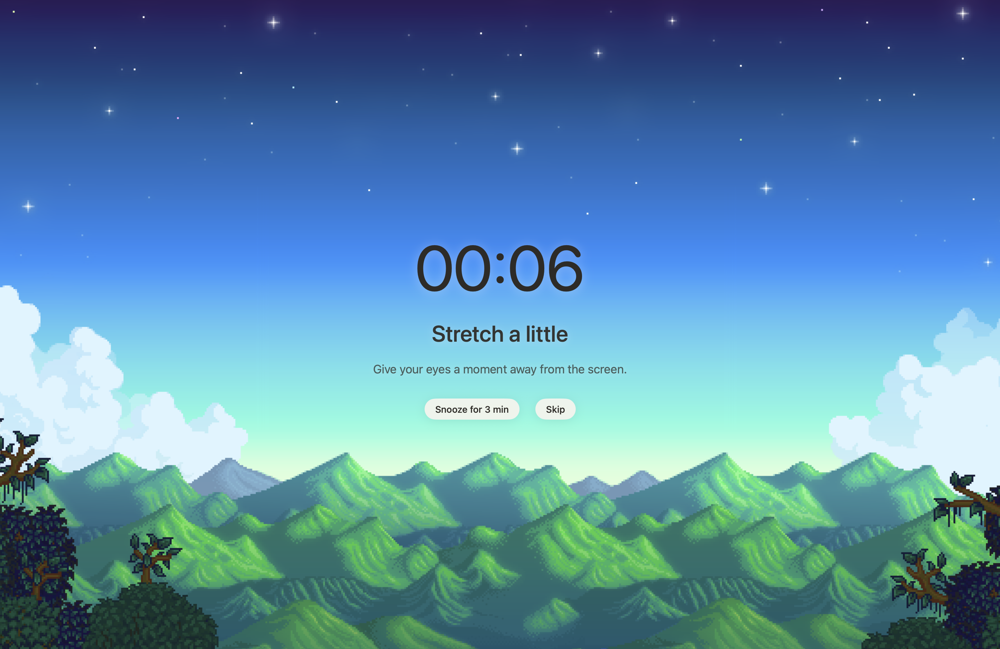

## See your rhythm at a glance

The menu bar popover keeps the current stage, remaining time, and next action together. Pause, resume, reset the timer, or start a break right away. When you are busy, you can snooze or skip a break.

<p align="center">
  <a href="screenshots/timer-popover-running-jade.en.png">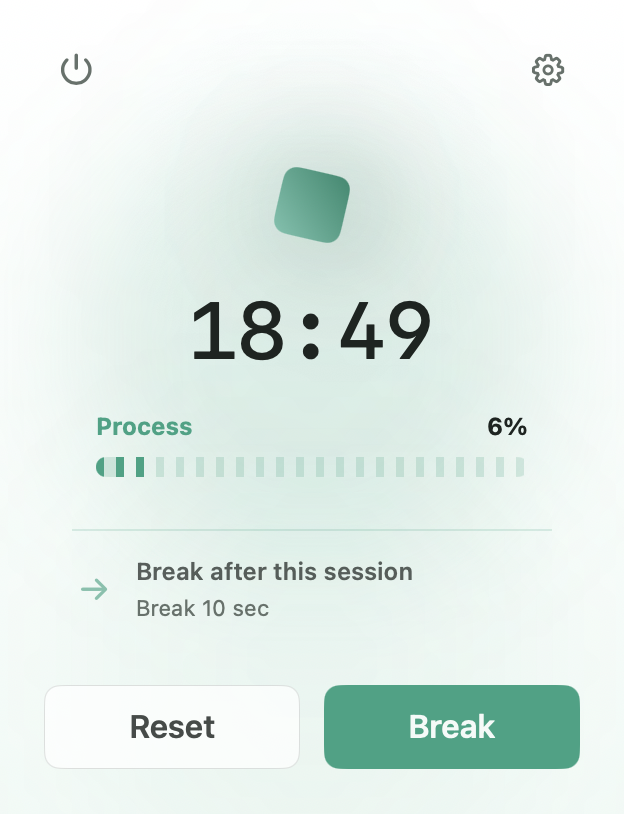</a>
  <a href="screenshots/timer-popover-mirroring-light.en.png">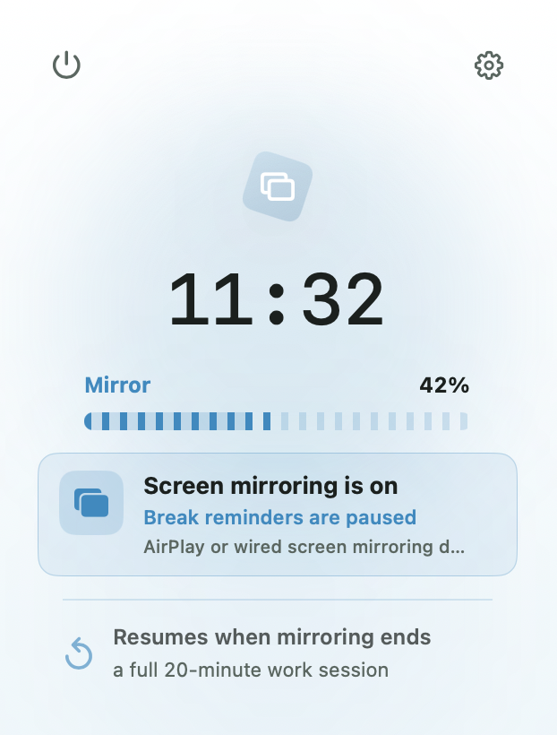</a>
  <a href="screenshots/timer-popover-paused-jade.en.png">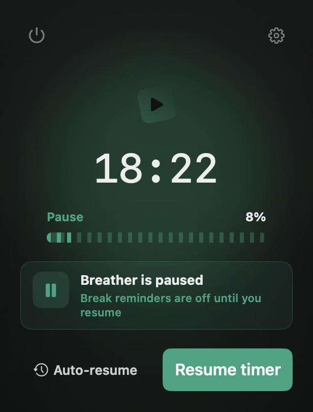</a>
</p>

<p align="center"><sub>Left: working · Center: mirroring pause · Right: manual pause<br>Click an image to view full size.</sub></p>

## Rest themes

Nine scenes for different kinds of pauses. Choose a theme, prompts, and sounds in **Settings → Break screen**. Use **Full-screen preview** at the bottom to experience the animation without affecting your work timer.

[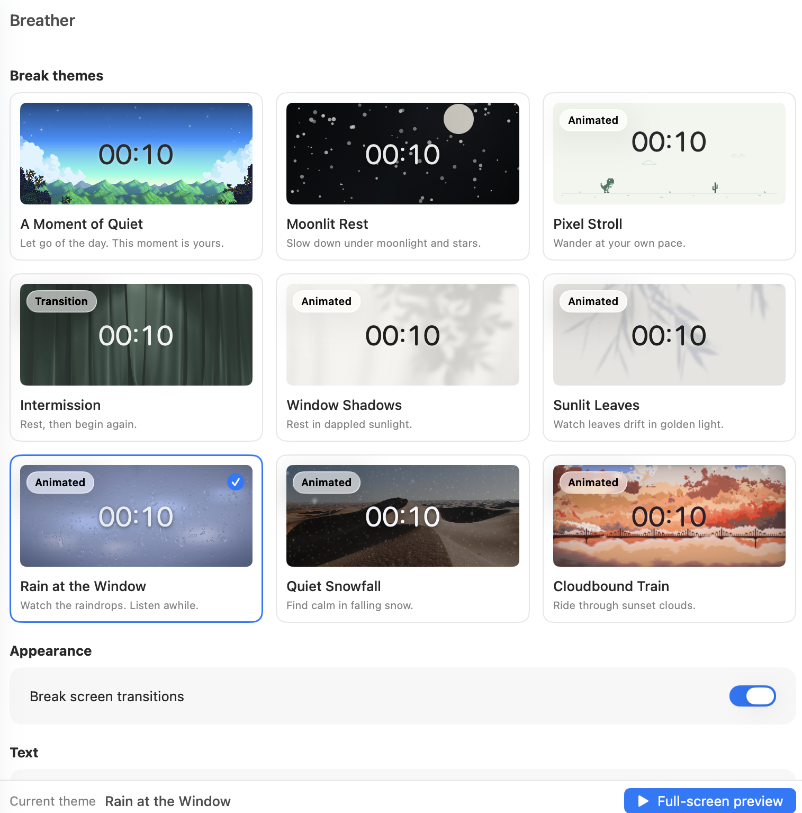](screenshots/rest-theme-picker.en.png)

<p align="center"><sub>Rest-theme selection (click to view full size)</sub></p>

I put little things I love into these scenes: a game dinosaur, curtains before bed, a breeze through an open window, and a train heading somewhere far away.

### Starting with things I love

**A Moment of Quiet:** The first design was meant to be simple and restrained. It holds some of the comfort I find in Stardew Valley: after a busy day, there is still somewhere to rest.

**Pixel Stroll:** I have always liked Chrome's little dinosaur, so I made it green and gave it a home in Breather. It strolls and hops over cacti on its own, with no score and no way to fail.

<p align="center">
  <a href="screenshots/rest-pixel-stroll-light.en.png">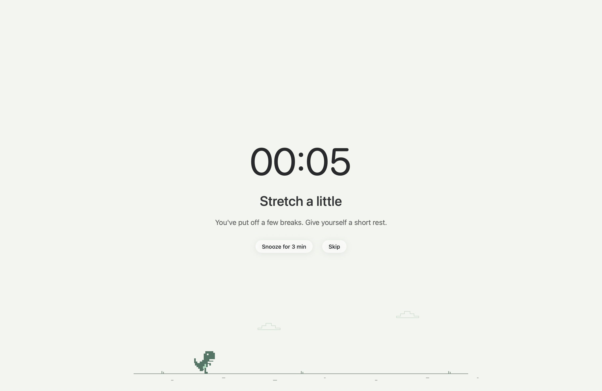</a>
  <a href="screenshots/rest-pixel-stroll-dark.en.png">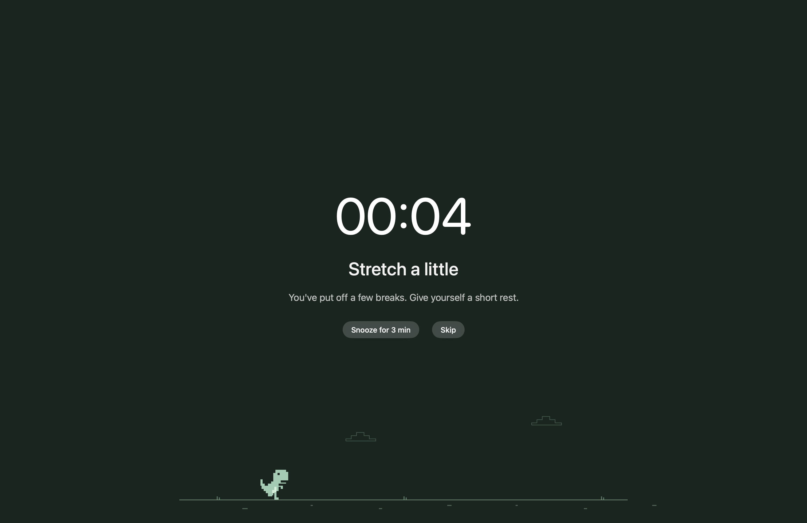</a>
</p>

<p align="center"><sub>Left: light mode · Right: dark mode (click an image to view full size)</sub></p>

### Curtains, moonlight, and a breeze

**Intermission:** Closing the curtains before bed reminded me of a stage opening and closing. It felt like a gentle transition between work and rest.

**Moonlit Rest:** I designed it as Mid-Autumn Festival approached. Thinking of reunion, I wanted to hang a round moon in the sky.

**Window Shadows and Sunlit Leaves:** Many nights while making Breather, I opened the window and felt a breeze move the leaves and cast shadows on the wall. The nighttime and daytime scenes grew from that same breeze.

<p align="center">
  <a href="screenshots/rest-curtain-countdown.en.png">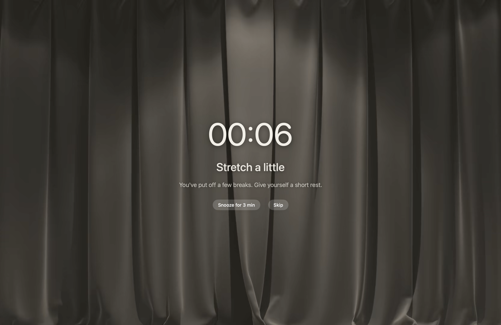</a>
  <a href="screenshots/rest-leaves-countdown.en.png">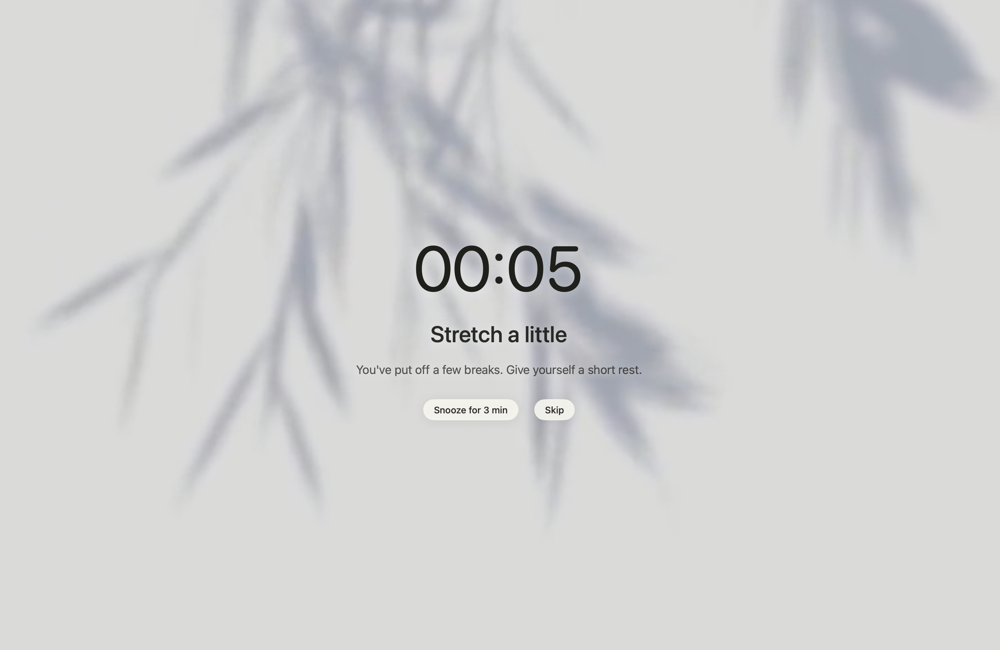</a>
</p>

<p align="center"><sub>Left: Intermission · Right: Window Shadows (click an image to view full size)</sub></p>

### Rain and snowfall

**Rain at the Window:** I sometimes close my eyes during a break, so I added a continuous rain sound alongside the view. I can listen and slowly relax without looking at the screen.

**Quiet Snowfall:** Beyond sunny and rainy days, I wanted a snowy one. Thank you to beining for the background image; the desert snowfall he shared inspired this theme.

[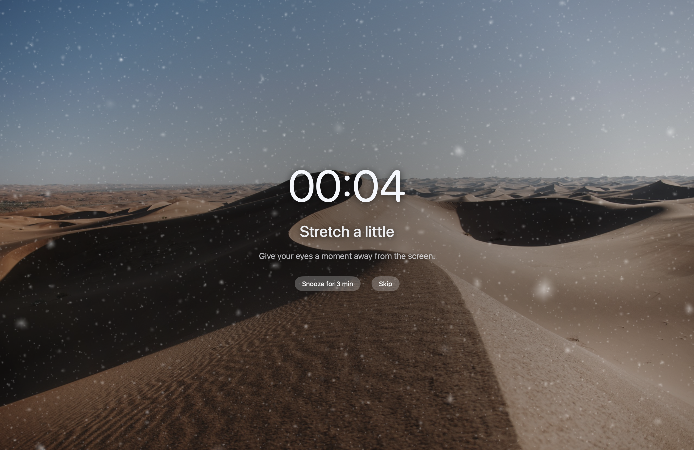](screenshots/rest-snow-countdown.en.png)

<p align="center"><sub>Quiet Snowfall · Full-screen break (click to view full size)</sub></p>

### Somewhere far away

**Cloudbound Train:** A train crossing a sea of clouds feels as free as a journey in an animated film. I hope we keep a little courage to set out, and stay young at heart.

[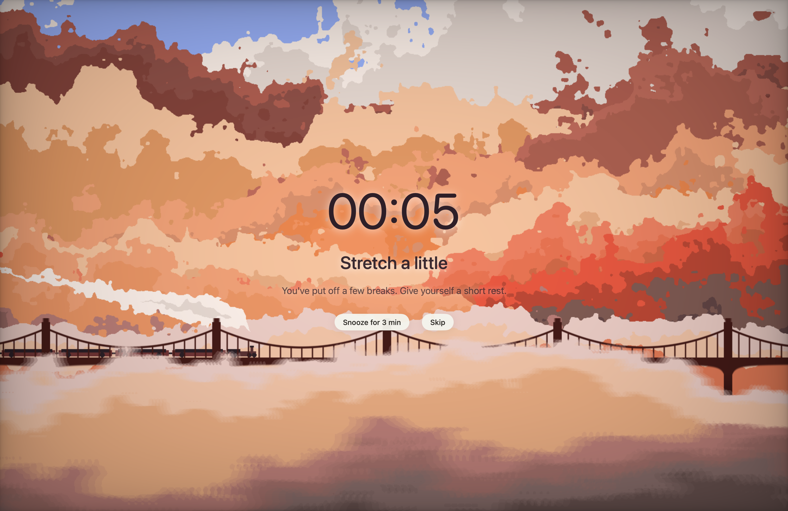](screenshots/rest-cloud-train-countdown.en.png)

<p align="center"><sub>Cloudbound Train · Full-screen break (click to view full size)</sub></p>

## Native settings, kept calm

Settings opens to **Schedule**, keeping everyday work and break choices close at hand.

- **Work and breaks:** Adjust durations, skip and snooze behavior. Apply timing changes now or in the next cycle.
- **Advance reminder:** Enabled by default, 20 seconds before a break. You can turn it off and check notification status beside the advance time.
- **Automatic breaks:** By default, locking your Mac or putting it to sleep for at least 5 minutes starts a fresh work timer when you return. Adjust the duration, include keyboard and mouse inactivity, or turn recognition off.
- **Language and appearance:** Use Simplified Chinese, Traditional Chinese, English, or your system language. Language changes take effect immediately.

[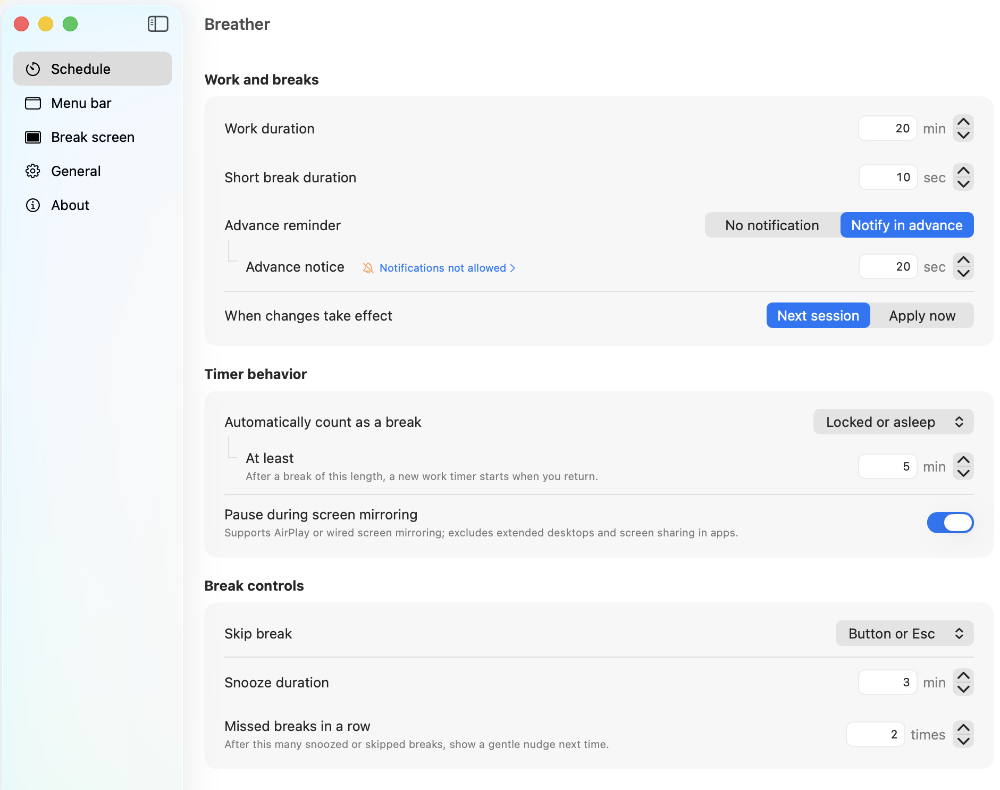](screenshots/settings-schedule.en.png)

<p align="center"><sub>Custom configuration example (click to view full size)</sub></p>

### Colors and menu bar icons

Sometimes a different color can change the mood. Choose a popover color and icon in **Settings → Menu bar** that feel comfortable to keep in the corner of your screen.

<p align="center">
  <a href="screenshots/settings-theme-picker.en.png">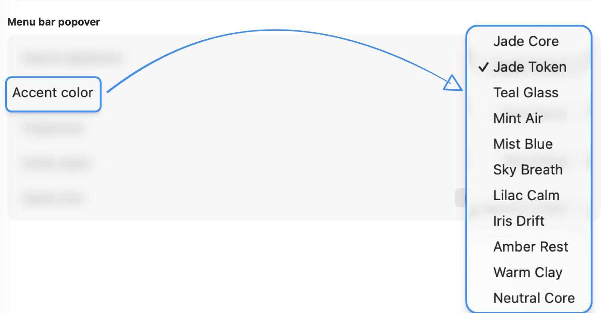</a>
  <a href="screenshots/settings-menu-bar-icon-picker.en.png">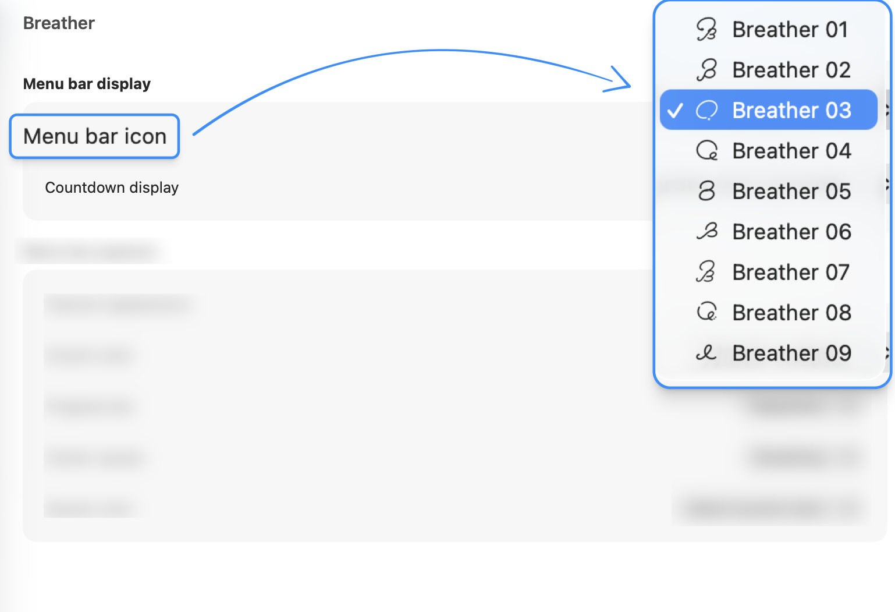</a>
</p>

<p align="center"><sub>Left: popover colors · Right: menu bar icons (click an image to view full size)</sub></p>

## Download and install

Requires **macOS 15 or later**. The universal DMG supports both Apple silicon and Intel Macs.

### Install with Homebrew

```sh
brew install --cask M3tar/tap/breather
```

Then open Breather from Applications. To update:

```sh
brew update
brew upgrade --cask M3tar/tap/breather
```

Homebrew downloads the original Release DMG and checks its checksum. New versions become available after the [tap is updated](https://github.com/M3tar/homebrew-tap).

### Download the DMG

Download the latest DMG from [GitHub Releases](https://github.com/M3tar/Breather/releases/latest), open it, and drag **Breather** into **Applications**. Launch it from Applications.

Breather checks for updates in the background. You can also check manually in **Settings → About**. For a manual installation, download the new DMG and replace the app.

### First launch and existing installations

Breather is not yet signed with an Apple Developer ID or notarized by Apple. Install from this project's GitHub Releases or the Homebrew tap above.

If macOS blocks the first launch, try opening Breather once, then go to **System Settings → Privacy & Security → Security** and choose **Open Anyway**. See [Apple's guidance](https://support.apple.com/guide/mac-help/open-a-mac-app-from-an-unknown-developer-mh40616/mac) for details.

To switch from a manual installation to Homebrew, quit Breather, move the existing copy out of Applications, and keep it as a backup. See the [tap instructions](https://github.com/M3tar/homebrew-tap) for migration and uninstallation.

## Known limits

- **Screen sharing inside meeting apps is not detected automatically.** Automatic pausing supports AirPlay and wired display mirroring, excluding extended desktops. When sharing through Tencent Meeting, Feishu, Zoom, Microsoft Teams, or similar software, pause Breather manually; you can also set a resume time.
- **macOS controls desktop notifications.** If a reminder does not appear, check permission and desktop-alert status in **Settings → General**.
- **Connecting or disconnecting a display may cause a brief hitch.** This remains a performance observation for follow-up.

## Feedback

If something feels good—or gets in your way—I would love to hear about it through the email link in **Settings → About** or [GitHub Issues](https://github.com/M3tar/Breather/issues).

## Release history

Each row covers the main changes. Follow a version link for full release notes and downloads.

| Version | Main changes |
| --- | --- |
| [0.5.0](https://github.com/M3tar/Breather/releases/tag/v0.5.0) | Three interface languages, dedicated Menu bar settings, improved break recognition and notifications, lower background CPU use, and Homebrew installation guidance. |
| [0.4.0](https://github.com/M3tar/Breather/releases/tag/v0.4.0) | Background update checks with quiet menu bar and Settings hints; motion labels on theme cards. |
| [0.3.0](https://github.com/M3tar/Breather/releases/tag/v0.3.0) | Nine rest themes, improved multi-display and preview behavior, and an About page with feedback links. |
| [0.2.0](https://github.com/M3tar/Breather/releases/tag/v0.2.0) | Native settings redesign, mirroring protection, and improved pause, notification, and rule changes. |
| [0.1.0](https://github.com/M3tar/Breather/releases/tag/v0.1.0) | First public preview with the timer and full-screen break experience. |

## Build from source

Clone the repository, open `Breather.xcodeproj`, select the **Breather** scheme, and press `Command + R`:

```sh
git clone https://github.com/M3tar/Breather.git
cd Breather
open Breather.xcodeproj
```

Xcode Debug builds use the display name **Breather Debug** and bundle identifier `com.mercury.breather.debug`. Installed releases use `com.mercury.breather`, so their settings and notification permissions remain independent.

<details>
<summary><strong>Project structure and command-line tools</strong></summary>

`Core` holds settings, break rules, and scheduling. `System` handles computer activity, mirroring, notifications, sounds, and login items. `Features` groups the interface by menu bar, break screen, and settings. Assets and translations for all three languages live in `Resources`.

You can also run the Swift Package executable:

```sh
swift run Breather
```

Build the Xcode project from the command line:

```sh
xcodebuild \
  -project Breather.xcodeproj \
  -scheme Breather \
  -configuration Debug \
  -derivedDataPath build/DerivedData \
  CLANG_MODULE_CACHE_PATH=build/ModuleCache \
  build
```

Create a compressed release DMG:

```sh
./scripts/build-dmg.sh 0.5.0
```

The artifact is written to `dist/Breather-0.5.0.dmg`. On a development Mac with stale release registrations, inspect and repair LaunchServices with:

```sh
./scripts/reset-local-release-registration.sh --dry-run
./scripts/reset-local-release-registration.sh --apply
```

The repair tool only changes LaunchServices registration; it never deletes an app or its settings.

</details>

## License

Breather source code is available under the [MIT License](LICENSE). The original Breather icons were created by M3tar. Copyright in the included sound effects and background images remains with their respective rights holders; those assets are not covered by the source-code license.

Parts of the rain and snow shaders use CC BY-NC-SA 3.0, which includes a noncommercial restriction. The Cloudbound Train shader and blue-noise image are also outside the source code's MIT license.

<details>
<summary><strong>Third-party asset attribution and licenses</strong></summary>

Exception: the Heartfelt rain geometry in `RainGlassMetalBackdrop.swift` is adapted from [Heartfelt by Martijn Steinrucken / BigWings](https://www.shadertoy.com/view/ltffzl) (2017), licensed [CC BY-NC-SA 3.0](https://creativecommons.org/licenses/by-nc-sa/3.0/). That shader adaptation is not offered under MIT and is not available for commercial use under the cited license. The Metal port and generated blue-gray background are modifications; the original Shadertoy background image is not included.

The snowfall geometry in `SnowfallMetalBackdrop.swift` is a Metal port of [Just snow by Andrew Baldwin / baldand](https://www.shadertoy.com/view/ldsGDn) (2013), also licensed [CC BY-NC-SA 3.0](https://creativecommons.org/licenses/by-nc-sa/3.0/). It is not offered under MIT or available for commercial use under that license. The app uses a compressed desert photograph behind the snow and no mouse offset.

The cloud train theme in `CloudTrainMetalBackdrop.swift` adapts [Up in the Cloud Sea by mdb](https://www.shadertoy.com/view/Ndc3zl). Its blue-noise PNG comes from the [Cloudglen Express study](https://github.com/HoytXU/cloudglen_express). The original shader and that PNG are third-party material, not part of Breather's MIT grant. The original shader's `iChannel1` overlay asset is not included.

</details>
