<p align="center">
  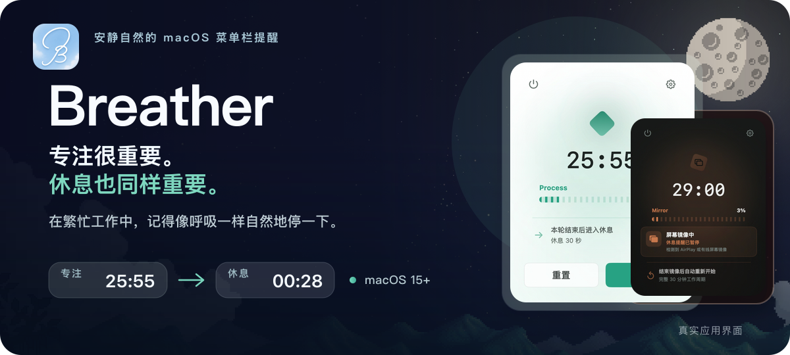
</p>

<p align="center">
  <a href="README.md">English</a> · <a href="README.zh-CN.md"><strong>简体中文</strong></a>
  <br><br>
  <a href="https://github.com/M3tar/Breather/releases/latest"><strong>下载 Breather DMG</strong></a> · <a href="#使用-homebrew">Homebrew 安装</a> · <a href="#版本更新">版本更新</a>
</p>

我做了一个提醒自己停一停的 macOS 小工具。做东西时，我常常一坐就是很久；明明知道该休息，提醒弹出来，手还是会顺势把它划掉。

于是有了 Breather。它平时安静地待在菜单栏里；到时间了，就在每台显示器上给休息留一小段时间。站起来、喝口水、看看远处，回来再继续。

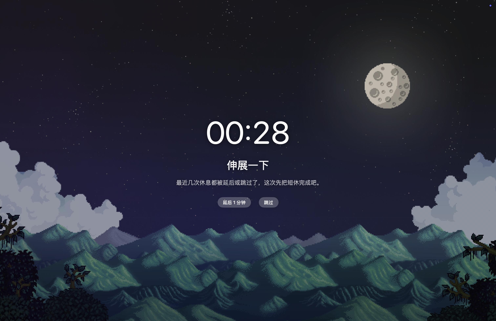

## 工作节奏，一眼看清

菜单栏弹窗集中展示当前阶段、剩余时间和下一步操作。你可以暂停、继续、重置计时，或立即休息；忙的时候，也可以延后或跳过休息。

<p align="center">
  <a href="screenshots/timer-popover-running-jade.jpg">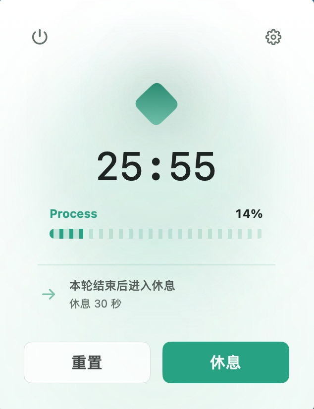</a>
  <a href="screenshots/timer-popover-mirroring-light.jpg">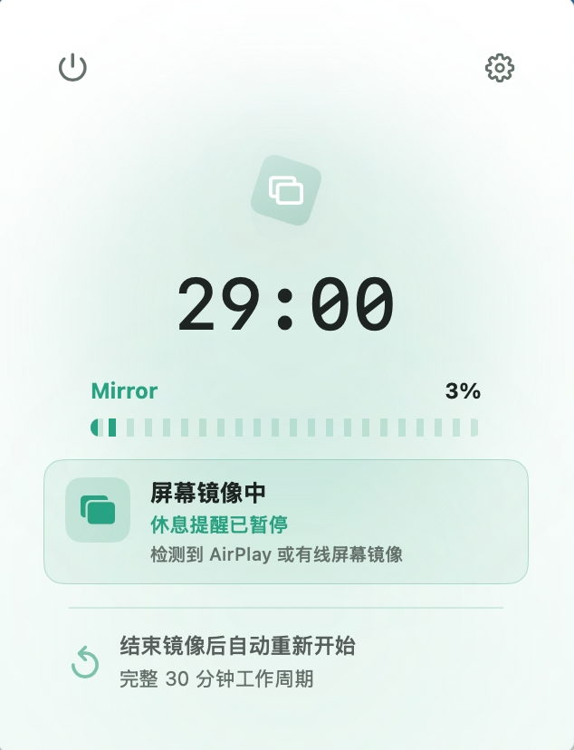</a>
  <a href="screenshots/timer-popover-paused-jade.jpg">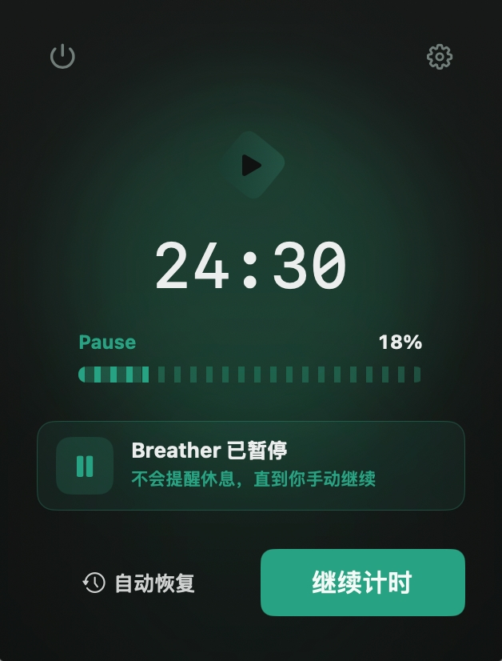</a>
</p>

<p align="center"><sub>左：工作中　·　中：镜像暂停　·　右：手动暂停（点击图片查看原尺寸）</sub></p>

## 休息主题

九种画面，留给不同心情的休息。在“设置 → 休息界面”选择主题、提示语和声音；通过底部的“全屏预览”体验动态效果，不影响工作计时。

[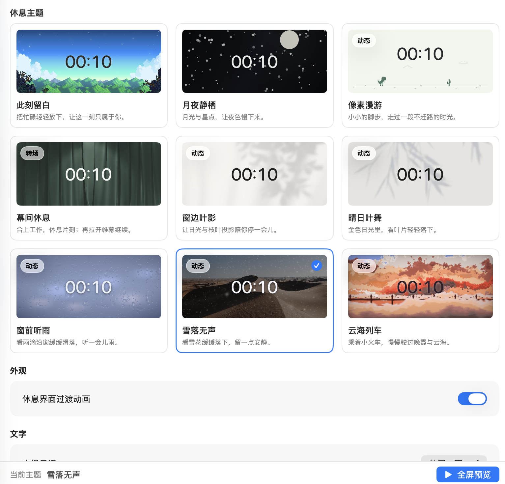](screenshots/rest-theme-picker.zh-CN.png)

<p align="center"><sub>休息主题选择（点击图片查看原尺寸）</sub></p>

做这些画面时，我把喜欢的日常也放了进去：游戏里的小恐龙、睡前的窗帘、夜里吹进来的风，还有一列想去远方的火车。

### 从喜欢的东西开始

**此刻留白：** 最早的一版，想做得简单、克制一点。里面也留着我喜欢《星露谷物语》时的心情：忙完以后，幸好还有一个地方可以歇一歇。

**像素漫游：** 我一直喜欢 Chrome 那只小恐龙，于是把它调成绿色，放进了 Breather。它会自己漫步、跳过仙人掌，没有分数，也不会失败。

<p align="center">
  <a href="screenshots/rest-pixel-roam-light-render.png">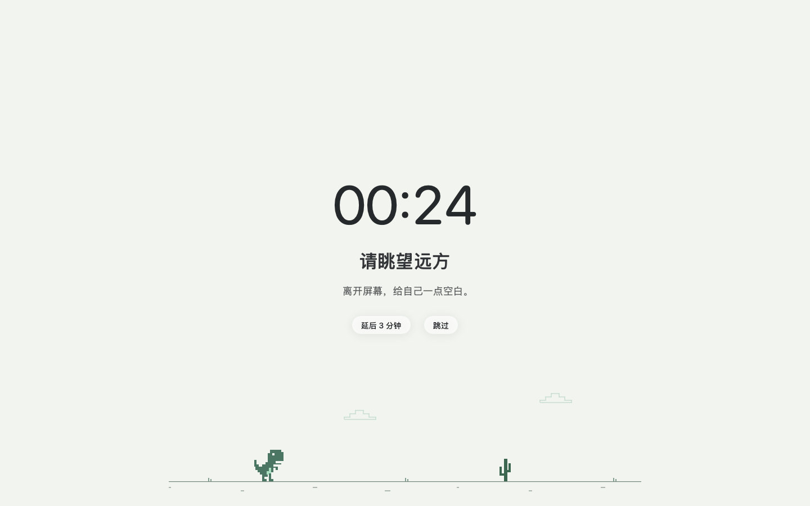</a>
  <a href="screenshots/rest-pixel-roam-dark-render.png">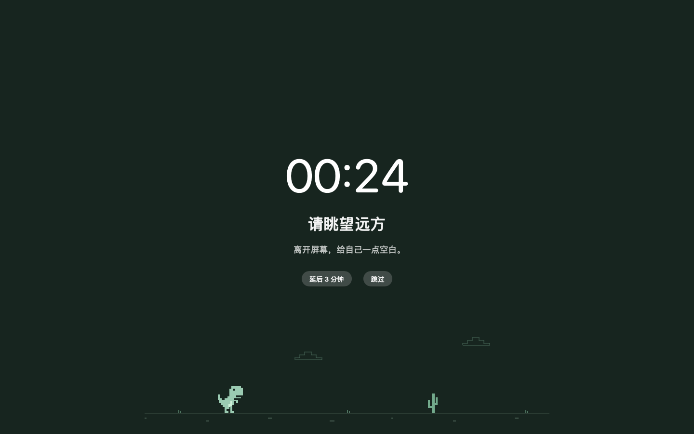</a>
</p>

<p align="center"><sub>左：浅色模式　·　右：深色模式（实际组件渲染，点击图片查看原尺寸）</sub></p>

### 窗帘、月光与晚风

**幕间休息：** 某晚睡前拉窗帘时想到：窗帘的开合，很像舞台的开幕与谢幕。工作和休息，也可以有这样一个轻轻的转场。

**月夜静栖：** 设计时正好临近中秋，想到团圆，就想在天空挂一轮圆圆的月亮。

**窗边叶影与晴日叶舞：** 许多做 Breather 的夜晚，我会把窗打开。微风吹过树叶，在墙上留下影子；夜晚与晴日的两个画面，就从这里来。

<p align="center">
  <a href="screenshots/rest-curtain-countdown.png">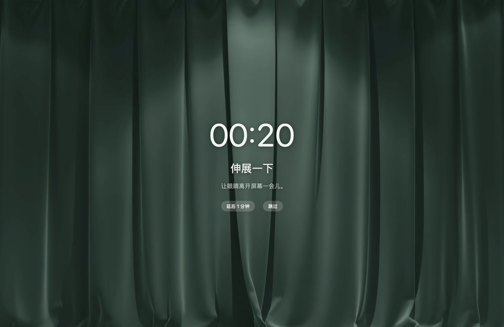</a>
  <a href="screenshots/rest-leaves-countdown.png">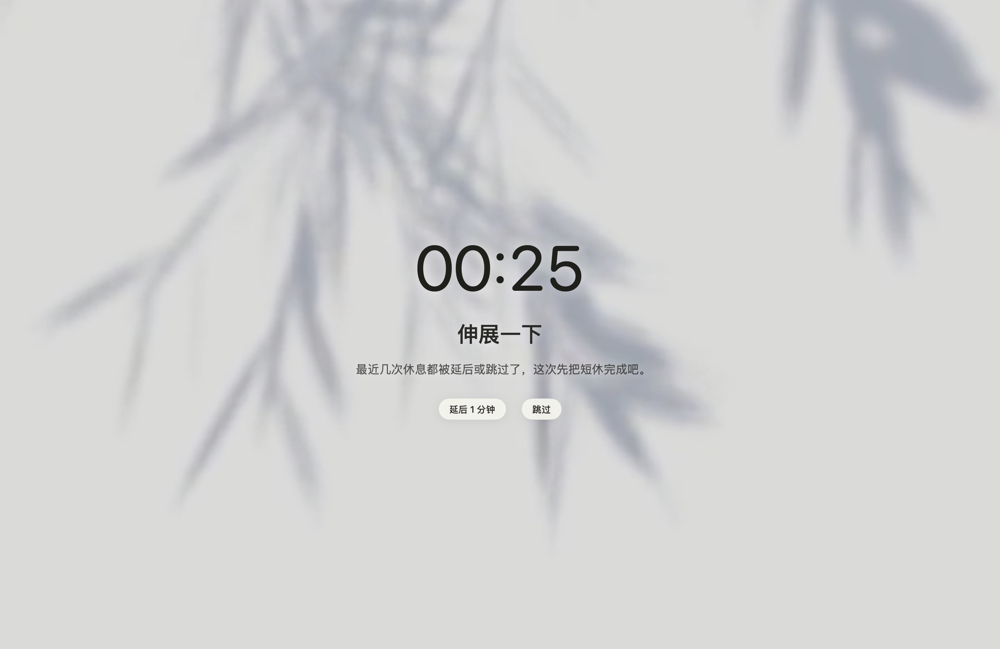</a>
</p>

<p align="center"><sub>左：幕间休息　·　右：窗边叶影（点击图片查看原尺寸）</sub></p>

### 雨声和落雪

**窗前听雨：** 有时休息，我会闭上眼睛。所以除了雨景，也加入持续的雨声；不用看屏幕，也能听着雨慢慢放松。

**雪落无声：** 有晴天、雨天，也该有雪天。感谢 beining 同学提供背景图；他分享的沙漠落雪画面给了我灵感。

[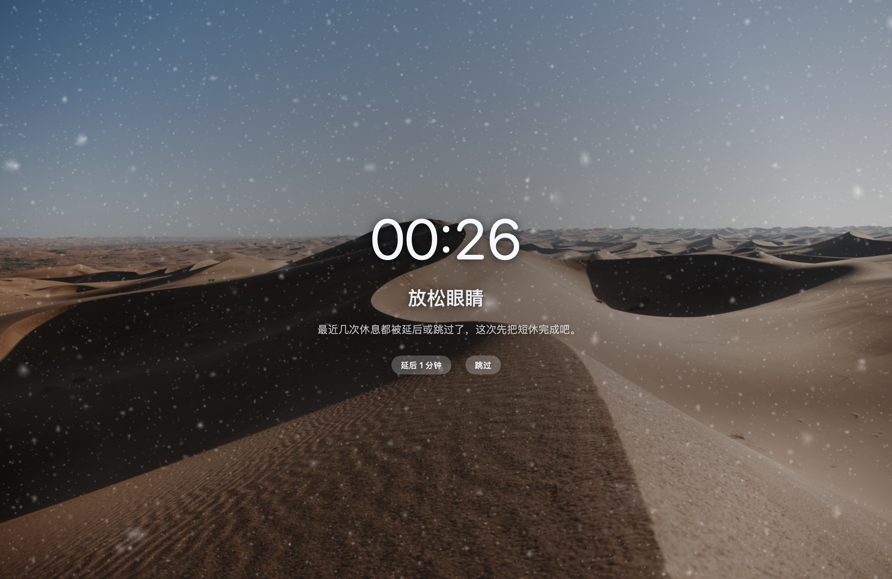](screenshots/rest-snow-countdown.png)

<p align="center"><sub>雪落无声 · 全屏休息界面（点击图片查看原尺寸）</sub></p>

### 去远方

**云海列车：** 列车从云海驶过，像动漫里的远行一样自由。愿我们一直保有一点出发的勇气，也一直年轻。

[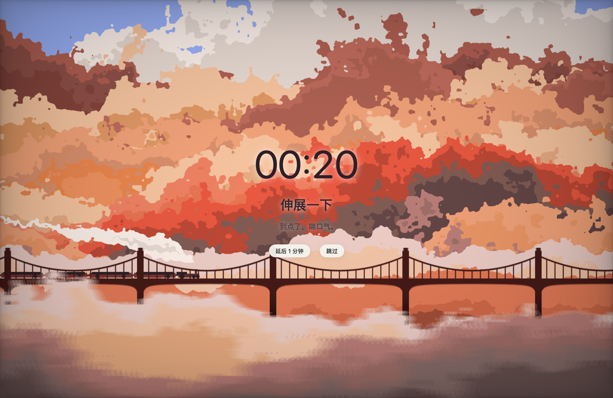](screenshots/rest-cloud-train-countdown.png)

<p align="center"><sub>云海列车 · 全屏休息界面（点击图片查看原尺寸）</sub></p>

## 原生设置，保持安静

默认打开“计划”，把常用的工作与休息安排放在眼前。

- **工作与休息：** 调整时长、跳过与延后行为，规则可以立即应用或留到下个周期。
- **休息前通知：** 默认提前 20 秒，也可以关闭；提前时间旁可查看系统通知状态。
- **自动计为休息：** 默认识别锁屏或电脑睡眠，满 5 分钟后，返回时开始新的工作计时。也可调整时长、包含无键鼠操作，或关闭识别。
- **语言与外观：** 支持简体中文、繁体中文、英文及跟随系统，切换后立即更新界面。

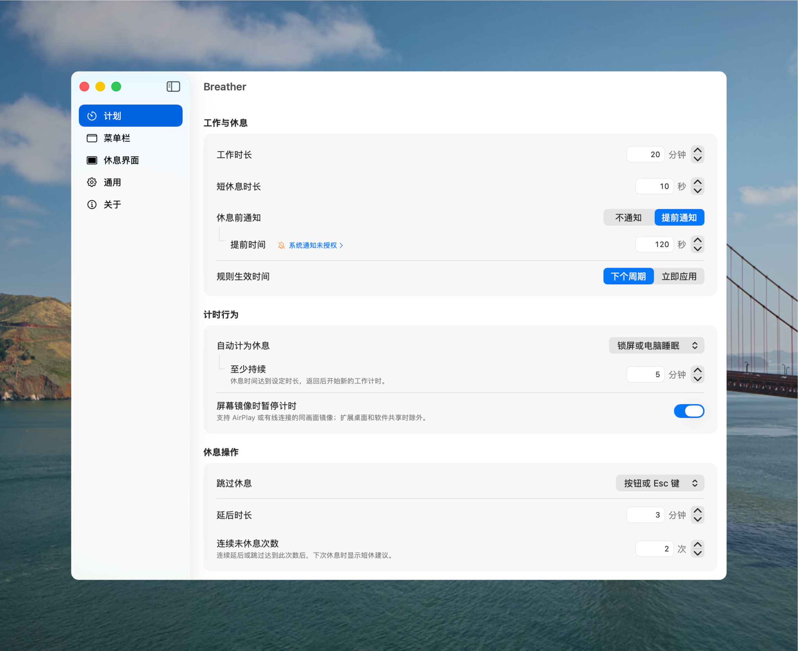

<p align="center"><sub>截图为自定义配置示例。</sub></p>

### 主题色与菜单栏图标

有时换一种颜色，也能换一种心情。在“设置 → 菜单栏”选择弹窗主题色与图标，挑一个看着舒服的就好。

<p align="center">
  <a href="screenshots/settings-theme-picker.jpg">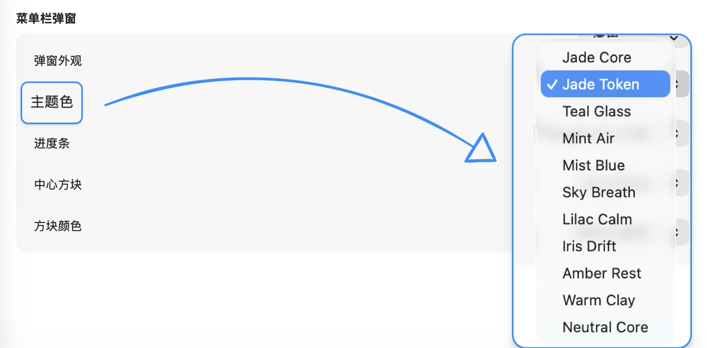</a>
  <a href="screenshots/settings-menu-bar-icon-picker.zh-CN.png">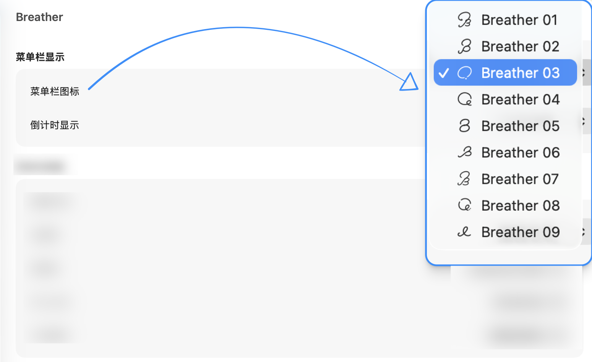</a>
</p>

<p align="center"><sub>左：弹窗主题色　·　右：菜单栏图标（点击图片查看原尺寸）</sub></p>

## 下载与安装

需要 **macOS 15 或更高版本**，通用 DMG 支持 Apple 芯片与 Intel Mac。

### 使用 Homebrew

```sh
brew install --cask M3tar/tap/breather
```

安装后，从“应用程序”打开 Breather。更新使用：

```sh
brew update
brew upgrade --cask M3tar/tap/breather
```

Homebrew 下载原始 Release DMG 并核对校验值，新版本在 [tap 更新](https://github.com/M3tar/homebrew-tap)后可用。

### 下载 DMG

前往 [GitHub Releases](https://github.com/M3tar/Breather/releases/latest) 下载最新 DMG，打开后将 **Breather** 拖入 **Applications（应用程序）**，再从应用程序文件夹启动。

应用会在后台检查更新，也可以在“设置 → 关于”手动检查。手动安装的用户，下载新 DMG 后替换应用即可。

### 首次启动与已有安装

Breather 尚未使用 Apple Developer ID 签名，也未通过 Apple 公证。请从本项目的 GitHub Releases 或上述 Homebrew tap 安装。

如果 macOS 阻止首次启动，请先尝试打开一次 Breather，再进入 **系统设置 → 隐私与安全性 → 安全性**，点击 **仍要打开**。详情见 [Apple 的相关说明](https://support.apple.com/zh-cn/guide/mac-help/open-a-mac-app-from-an-unknown-developer-mh40616/mac)。

从手动安装改用 Homebrew 时，请先退出应用、移出旧副本并保留备份。迁移与卸载方法见 [tap 安装说明](https://github.com/M3tar/homebrew-tap)。

## 已知限制

- **会议软件共享暂不支持自动识别。** 自动暂停支持 AirPlay 和有线连接的同画面镜像，扩展桌面除外。腾讯会议、飞书、Zoom、Microsoft Teams 等软件共享屏幕时，请手动暂停 Breather，也可以设置自动恢复。
- **桌面通知由系统控制。** 如果没有看到提醒，可在“设置 → 通用”检查授权与桌面提醒状态。
- **显示器插拔可能短暂停顿。** 这仍是后续性能观察项。

## 反馈

哪里让你觉得舒服，或者哪里打扰了你，都欢迎通过“设置 → 关于”中的邮件或 [GitHub Issues](https://github.com/M3tar/Breather/issues)告诉我。

## 版本更新

每版主要变化如下，点击版本号查看完整更新与下载。

| 版本 | 主要更新 |
| --- | --- |
| [0.5.0](https://github.com/M3tar/Breather/releases/tag/v0.5.0) | 三种界面语言、独立菜单栏设置页；改进休息识别与通知提示，降低后台 CPU 占用，补充 Homebrew 安装说明。 |
| [0.4.0](https://github.com/M3tar/Breather/releases/tag/v0.4.0) | 后台检查更新，在菜单栏与设置中轻量提示；主题卡片增加动态标记。 |
| [0.3.0](https://github.com/M3tar/Breather/releases/tag/v0.3.0) | 九种休息主题、多显示器与预览体验；新增“关于”页和反馈入口。 |
| [0.2.0](https://github.com/M3tar/Breather/releases/tag/v0.2.0) | 原生设置重构、镜像保护，以及暂停、通知与规则生效体验改进。 |
| [0.1.0](https://github.com/M3tar/Breather/releases/tag/v0.1.0) | 首个公开预览版，包含计时与全屏休息体验。 |

## 从源码构建

克隆仓库并打开 `Breather.xcodeproj`，在 Xcode 中选择 **Breather** Scheme，然后按 `Command + R`：

```sh
git clone https://github.com/M3tar/Breather.git
cd Breather
open Breather.xcodeproj
```

Xcode Debug 构建使用独立名称 **Breather Debug** 和 Bundle ID `com.mercury.breather.debug`；安装版使用 `com.mercury.breather`。两者的设置和通知权限相互独立。

<details>
<summary><strong>项目结构与命令行工具</strong></summary>

`Core` 保存设置、休息规则与计时调度；`System` 处理电脑活动、镜像、通知、声音和登录项；`Features` 按菜单栏、休息界面与设置拆分界面。资源与三种语言的翻译位于 `Resources`。

也可以运行 Swift Package 可执行目标：

```sh
swift run Breather
```

使用命令行构建 Xcode 工程：

```sh
xcodebuild \
  -project Breather.xcodeproj \
  -scheme Breather \
  -configuration Debug \
  -derivedDataPath build/DerivedData \
  CLANG_MODULE_CACHE_PATH=build/ModuleCache \
  build
```

生成压缩的发布 DMG：

```sh
./scripts/build-dmg.sh 0.5.0
```

安装包会写入 `dist/Breather-0.5.0.dmg`。如果开发机积累了旧的发布版注册记录，可以检查并修复 LaunchServices：

```sh
./scripts/reset-local-release-registration.sh --dry-run
./scripts/reset-local-release-registration.sh --apply
```

修复工具只会修改 LaunchServices 注册，不会删除应用或设置。

</details>

## 许可证

Breather 源代码采用 [MIT License](LICENSE) 开源。Breather 原创图标由 M3tar 绘制；内置声音与背景图片的版权归各自权利人所有，这些素材不适用于源代码所采用的许可证。

雨、雪主题使用的部分着色器几何适用 CC BY-NC-SA 3.0，包含非商业使用限制；云海列车着色器与蓝噪声图片也不属于源代码的 MIT 授权范围。

<details>
<summary><strong>第三方素材归属与许可</strong></summary>

例外：`RainGlassMetalBackdrop.swift` 中的 Heartfelt 雨滴几何改编自 Martijn Steinrucken / BigWings 于 2017 年创作的 [Heartfelt](https://www.shadertoy.com/view/ltffzl)，适用 [CC BY-NC-SA 3.0](https://creativecommons.org/licenses/by-nc-sa/3.0/)，不属于 MIT 授权，依该许可不可用于商业用途。Metal 移植及蓝灰色背景属于修改；原 Shadertoy 的背景图片未收录。

`SnowfallMetalBackdrop.swift` 中的雪花几何是 Andrew Baldwin / baldand 于 2013 年创作的 [Just snow](https://www.shadertoy.com/view/ldsGDn) 的 Metal 移植，同样适用 [CC BY-NC-SA 3.0](https://creativecommons.org/licenses/by-nc-sa/3.0/)，不属于 MIT 授权，依该许可不可用于商业用途。应用在雪景下方使用压缩后的沙漠照片，鼠标偏移固定为零。

云海列车主题 `CloudTrainMetalBackdrop.swift` 改编自 mdb 的 [Up in the Cloud Sea](https://www.shadertoy.com/view/Ndc3zl)。蓝噪声 PNG 取自 [Cloudglen Express 研究项目](https://github.com/HoytXU/cloudglen_express)。原着色器和该 PNG 属于第三方素材，不在 Breather 的 MIT 授权范围内。原着色器的 `iChannel1` 叠加纹理未收录。

</details>
